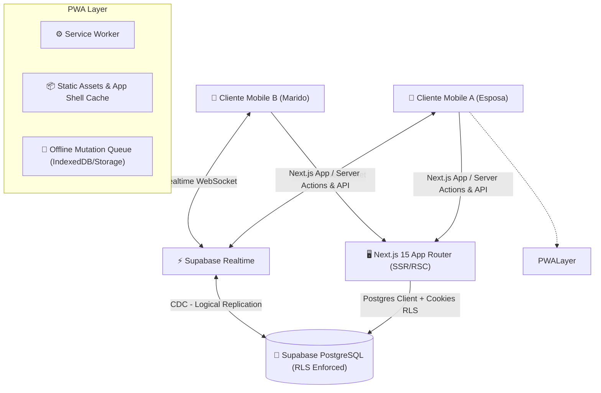
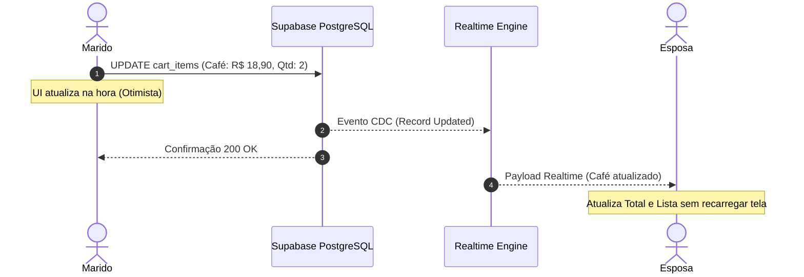

# ARCHITECTURE — Despensa

## 1. Visão Arquitetural

O **Despensa** é construído sob uma arquitetura modular baseada em **Feature-Driven Design** no **Next.js (App Router)** com backend assíncrono gerenciado no **Supabase** (Postgres + Auth + Realtime).



---

## 2. Stack Tecnológica e Racional Técnico

| Camada | Tecnologia | Justificativa |
|---|---|---|
| **Framework** | Next.js 15 (App Router) + React 19 | SSR rápido para carregamento de shell, RSC para segurança de dados, Server Actions para mutations semânticas. |
| **Linguagem** | TypeScript (Strict Mode) | Tipagem estrita de ponta a ponta com `supabase-gen-types` e validação Zod. |
| **Backend & Banco** | Supabase (PostgreSQL 15+) | RLS robusto nativo, Auth com sessões seguras em cookies HttpOnly, replicação lógica para tempo real. |
| **Realtime** | Supabase Realtime (Postgres Changes + Presence) | Mudanças refletidas no carrinho de compras em < 250ms em ambos os smartphones. |
| **Cache & Estado Assíncrono**| TanStack Query v5 | Gerenciamento de cache, refetch em reconexão de rede e controle otimista com rollback. |
| **Estilização** | Tailwind CSS v3.4/v4 + Tokens autorais | Estilização performática sem runtime overhead, variáveis CSS semânticas e suporte tátil. |
| **Componentes Base** | Radix UI Primitives / shadcn customizado | Acessibilidade garantida por padrão, customizada para fugir de qualquer estética padrão SaaS. |
| **Animações** | Motion (`framer-motion`) | Animações fluidas em lista, drawers bottom-sheet móveis, microinterações e transições de página. |
| **Formulários & Validação** | React Hook Form + Zod | Validação robusta de tipos, inputs controlados de preço e quantidades com feedback em tempo real. |
| **PWA & Offline** | Web App Manifest + Service Worker customizado | Experiência de app nativo instalável no iOS (Safari Add to Home) e Android (Chrome PWA). |

---

## 3. Estrutura de Pastas Modular

```
lista-de-compras/
├── docs/                        # Documentação técnica e design
├── public/
│   ├── icons/                   # Ícones PWA (192, 512, maskable, apple-touch)
│   ├── splash/                  # Telas de splash para iOS
│   └── manifest.webmanifest     # Manifesto PWA completo
├── src/
│   ├── app/                     # Next.js App Router
│   │   ├── (auth)/              # Rotas de Autenticação
│   │   │   ├── login/
│   │   │   ├── register/
│   │   │   └── layout.tsx
│   │   ├── (app)/               # Rotas autenticadas do produto
│   │   │   ├── page.tsx         # Início / Dashboard Editorial
│   │   │   ├── recurring/       # Lista Recorrente da Casa
│   │   │   ├── lists/           # Listas Mensais
│   │   │   ├── shopping/        # Modo Supermercado (Live Engine)
│   │   │   ├── history/         # Histórico e Métricas de Gastos
│   │   │   ├── household/       # Configurações do Lar e Convites
│   │   │   └── layout.tsx       # Layout com Shell Mobile e BottomNav
│   │   ├── invite/[token]/      # Aceitação de Convite de Compartilhamento
│   │   ├── api/                 # Endpoints REST e Webhooks auxiliares
│   │   ├── globals.css          # Variáveis de tema e tokens visuais
│   │   └── layout.tsx           # Root Layout com fontes e providers
│   ├── components/
│   │   ├── ui/                  # Componentes primitivos estilizados com identidade própria
│   │   │   ├── button.tsx
│   │   │   ├── dialog.tsx
│   │   │   ├── sheet.tsx        # Bottom sheets otimizados para mobile
│   │   │   ├── input.tsx
│   │   │   ├── badge.tsx
│   │   │   └── skeleton.tsx
│   │   └── common/              # Componentes de navegação e feedback
│   │       ├── bottom-nav.tsx   # Barra de navegação inferior autoral
│   │       ├── live-hud.tsx     # Orçamento e total flutuante no modo compras
│   │       ├── keypad-sheet.tsx # Teclado numérico ágil para registro de preços
│   │       └── sync-badge.tsx   # Indicador sutil de status online/offline
│   ├── features/                # Módulos de Domínio
│   │   ├── auth/                # Auth context, guards, forms
│   │   ├── household/           # Gerenciamento de lar, membros, convites
│   │   ├── products/            # Itens, categorias, unidades
│   │   ├── recurring/           # Lista recorrente base
│   │   ├── shopping-list/       # Gerador e editor de lista mensal
│   │   ├── shopping-session/    # Live shopping, cart realtime, cálculos
│   │   └── history/             # Histórico analítico de compras
│   ├── hooks/                   # Hooks reutilizáveis
│   │   ├── use-household.ts
│   │   ├── use-realtime-cart.ts
│   │   ├── use-network-status.ts
│   │   └── use-haptic-feedback.ts
│   ├── lib/                     # Utilitários e Clientes
│   │   ├── supabase/
│   │   │   ├── client.ts        # Browser client
│   │   │   ├── server.ts        # Server Component client
│   │   │   ├── middleware.ts    # Session refresh middleware
│   │   │   └── types.ts         # Tipos gerados do banco
│   │   ├── formatters/          # Moeda BRL, datas pt-BR, unidades
│   │   └── validations/         # Schemas Zod de domínio
│   └── types/                   # Tipos globais
├── supabase/
│   └── migrations/              # Migrações versionadas em SQL
└── tailwind.config.ts
```

---

## 4. Estratégia de Tempo Real e Concorrência

### 4.1. Fonte da Verdade: PostgreSQL
O Supabase Realtime **nunca** substitui a gravação física no banco de dados. Todas as operações transitam primeiro por queries/mutations SQL com verificação atômica de RLS.

### 4.2. Fluxo Concorrente no Modo Supermercado
1. **Marido** marca item "Café Torrado" como comprado e insere R$ 18,90 no smartphone.
2. A mutation no cliente dispara um `UPDATE cart_items` ou `INSERT cart_items` via client Supabase com mutação otimista na tela dele imediatamente.
3. O PostgreSQL executa o update, calcula o subtotal e emite evento pelo Logical Replication (CDC).
4. O canal WebSocket da sessão (`shopping-session:<session_id>`) despacha o payload `UPDATE` para a **Esposa**.
5. O hook `useRealtimeCart` no aparelho da Esposa recebe o evento e atualiza a lista de itens e o Sticky HUD com o novo total e saldo restante sem piscar a tela ou roubar o foco de scroll.



### 4.3. Tratamento de Conflitos (Last-Write-Wins com Timestamp)
- Se ambos editarem o mesmo item no mesmo segundo, o registro com maior `updated_at` prevalece no PostgreSQL.
- O campo de edição de preço utiliza debounce de 300ms antes do envio ao banco para evitar tempestade de requisições por digitação.

---

## 5. Estratégia PWA & Resiliência Offline

### 5.1. Cache e Service Worker
- Cache estático: HTML App Shell, stylesheets, Web Fonts e ícones SVG armazenados via Cache API.
- Estratégia: `Stale-While-Revalidate` para dados de navegação e `Network-First` com fallback em cache para a lista ativa.

### 5.2. Tolerância a Quedas no Supermercado
- O estado da sessão de compras ativa é espelhado no `localStorage`/`IndexedDB` do navegador.
- Caso o sinal 4G/5G oscile ou caia no interior do supermercado:
  1. O indicador visual `sync-badge` sinaliza suavemente "Trabalhando desconectado".
  2. O usuário continua marcando itens e inserindo preços; os itens são adicionados a uma fila local de mutations.
  3. Ao restabelecer a conexão (`navigator.onLine` e evento `online`), a fila é drenada em ordem FIFO para o PostgreSQL e os dados são reconciliados.

---

## 6. Segurança e Isolamento Multi-Tenant

- Todo dado pertence a um `household_id`.
- Função SQL `security definer` `get_user_household_id(auth.uid())` recupera o lar do usuário autenticado a partir do token JWT sem permitir injeção ou parâmetros arbitrários vindos do frontend.
- RLS ativado em **100% das tabelas**. Nenhuma chave `service_role` é incluída no bundle do frontend.
- Tokens de convite expiram em 7 dias, são hasheados e invalidados imediatamente após a primeira aceitação bem-sucedida.