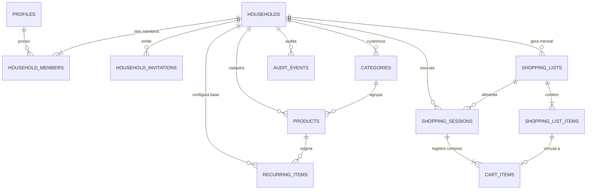

# DATABASE — Despensa: Modelagem Relacional & Políticas RLS

## 1. Diagrama Entidade-Relacionamento (ERD)



---

## 2. DDL e Estrutura das Tabelas

```sql
-- Extensões necessárias
CREATE EXTENSION IF NOT EXISTS "uuid-ossp";

-- 1. PROFILES (Extensão do auth.users)
CREATE TABLE profiles (
    id UUID PRIMARY KEY REFERENCES auth.users(id) ON DELETE CASCADE,
    full_name TEXT NOT NULL,
    avatar_url TEXT,
    updated_at TIMESTAMPTZ DEFAULT NOW(),
    created_at TIMESTAMPTZ DEFAULT NOW()
);

-- 2. HOUSEHOLDS (O contexto central de compartilhamento doméstico)
CREATE TABLE households (
    id UUID PRIMARY KEY DEFAULT uuid_generate_v4(),
    name TEXT NOT NULL DEFAULT 'Nosso Lar',
    currency TEXT NOT NULL DEFAULT 'BRL',
    monthly_budget NUMERIC(10, 2) DEFAULT 0.00,
    created_at TIMESTAMPTZ DEFAULT NOW(),
    updated_at TIMESTAMPTZ DEFAULT NOW()
);

-- 3. HOUSEHOLD_MEMBERS (Vínculo e papel do usuário no lar)
CREATE TYPE member_role AS ENUM ('admin', 'member');

CREATE TABLE household_members (
    id UUID PRIMARY KEY DEFAULT uuid_generate_v4(),
    household_id UUID NOT NULL REFERENCES households(id) ON DELETE CASCADE,
    user_id UUID NOT NULL REFERENCES profiles(id) ON DELETE CASCADE,
    role member_role NOT NULL DEFAULT 'member',
    joined_at TIMESTAMPTZ DEFAULT NOW(),
    UNIQUE (household_id, user_id)
);

CREATE INDEX idx_household_members_user ON household_members(user_id);
CREATE INDEX idx_household_members_household ON household_members(household_id);

-- 4. HOUSEHOLD_INVITATIONS (Links de convite seguros)
CREATE TYPE invitation_status AS ENUM ('pending', 'accepted', 'revoked', 'expired');

CREATE TABLE household_invitations (
    id UUID PRIMARY KEY DEFAULT uuid_generate_v4(),
    household_id UUID NOT NULL REFERENCES households(id) ON DELETE CASCADE,
    invited_by UUID NOT NULL REFERENCES profiles(id) ON DELETE CASCADE,
    token TEXT NOT NULL UNIQUE,
    status invitation_status NOT NULL DEFAULT 'pending',
    expires_at TIMESTAMPTZ NOT NULL,
    created_at TIMESTAMPTZ DEFAULT NOW(),
    accepted_at TIMESTAMPTZ
);

CREATE INDEX idx_invitations_token ON household_invitations(token);

-- 5. CATEGORIES (Categorias do lar com cores e ordenação)
CREATE TABLE categories (
    id UUID PRIMARY KEY DEFAULT uuid_generate_v4(),
    household_id UUID NOT NULL REFERENCES households(id) ON DELETE CASCADE,
    name TEXT NOT NULL,
    icon TEXT NOT NULL DEFAULT 'shopping-bag',
    color TEXT NOT NULL DEFAULT '#2A6B48',
    sort_order INT NOT NULL DEFAULT 0,
    created_at TIMESTAMPTZ DEFAULT NOW()
);

CREATE INDEX idx_categories_household ON categories(household_id);

-- 6. PRODUCTS (Catálogo geral de produtos do lar)
CREATE TABLE products (
    id UUID PRIMARY KEY DEFAULT uuid_generate_v4(),
    household_id UUID NOT NULL REFERENCES households(id) ON DELETE CASCADE,
    category_id UUID REFERENCES categories(id) ON DELETE SET NULL,
    name TEXT NOT NULL,
    default_unit TEXT NOT NULL DEFAULT 'un',
    default_price NUMERIC(10, 2) DEFAULT 0.00,
    notes TEXT,
    created_at TIMESTAMPTZ DEFAULT NOW(),
    updated_at TIMESTAMPTZ DEFAULT NOW()
);

CREATE INDEX idx_products_household ON products(household_id);
CREATE INDEX idx_products_category ON products(category_id);

-- 7. RECURRING_ITEMS (A lista-base recorrente do lar)
CREATE TABLE recurring_items (
    id UUID PRIMARY KEY DEFAULT uuid_generate_v4(),
    household_id UUID NOT NULL REFERENCES households(id) ON DELETE CASCADE,
    product_id UUID NOT NULL REFERENCES products(id) ON DELETE CASCADE,
    target_quantity NUMERIC(10, 2) NOT NULL DEFAULT 1,
    unit TEXT NOT NULL DEFAULT 'un',
    is_active BOOLEAN NOT NULL DEFAULT true,
    sort_order INT NOT NULL DEFAULT 0,
    created_at TIMESTAMPTZ DEFAULT NOW(),
    updated_at TIMESTAMPTZ DEFAULT NOW(),
    UNIQUE (household_id, product_id)
);

CREATE INDEX idx_recurring_household ON recurring_items(household_id);

-- 8. SHOPPING_LISTS (Instâncias de listas mensais geradas)
CREATE TYPE shopping_list_status AS ENUM ('draft', 'active', 'completed', 'archived');

CREATE TABLE shopping_lists (
    id UUID PRIMARY KEY DEFAULT uuid_generate_v4(),
    household_id UUID NOT NULL REFERENCES households(id) ON DELETE CASCADE,
    title TEXT NOT NULL,
    period_month INT NOT NULL CHECK (period_month BETWEEN 1 AND 12),
    period_year INT NOT NULL CHECK (period_year >= 2024),
    budget_target NUMERIC(10, 2) DEFAULT 0.00,
    status shopping_list_status NOT NULL DEFAULT 'draft',
    created_at TIMESTAMPTZ DEFAULT NOW(),
    updated_at TIMESTAMPTZ DEFAULT NOW(),
    UNIQUE (household_id, period_month, period_year)
);

CREATE INDEX idx_shopping_lists_household ON shopping_lists(household_id);

-- 9. SHOPPING_LIST_ITEMS (Itens planejados para a lista mensal)
CREATE TABLE shopping_list_items (
    id UUID PRIMARY KEY DEFAULT uuid_generate_v4(),
    shopping_list_id UUID NOT NULL REFERENCES shopping_lists(id) ON DELETE CASCADE,
    product_id UUID REFERENCES products(id) ON DELETE SET NULL,
    custom_name TEXT NOT NULL,
    category_id UUID REFERENCES categories(id) ON DELETE SET NULL,
    planned_quantity NUMERIC(10, 2) NOT NULL DEFAULT 1,
    unit TEXT NOT NULL DEFAULT 'un',
    estimated_price NUMERIC(10, 2) DEFAULT 0.00,
    is_added_during_shopping BOOLEAN NOT NULL DEFAULT false,
    created_at TIMESTAMPTZ DEFAULT NOW()
);

CREATE INDEX idx_shopping_list_items_list ON shopping_list_items(shopping_list_id);

-- 10. SHOPPING_SESSIONS (Sessão de compras ao vivo no supermercado)
CREATE TYPE session_status AS ENUM ('in_progress', 'completed', 'cancelled');

CREATE TABLE shopping_sessions (
    id UUID PRIMARY KEY DEFAULT uuid_generate_v4(),
    household_id UUID NOT NULL REFERENCES households(id) ON DELETE CASCADE,
    shopping_list_id UUID REFERENCES shopping_lists(id) ON DELETE SET NULL,
    started_by UUID NOT NULL REFERENCES profiles(id),
    started_at TIMESTAMPTZ DEFAULT NOW(),
    finished_at TIMESTAMPTZ,
    budget_target NUMERIC(10, 2) DEFAULT 0.00,
    total_spent NUMERIC(10, 2) DEFAULT 0.00,
    total_items_count INT DEFAULT 0,
    notes TEXT,
    status session_status NOT NULL DEFAULT 'in_progress'
);

CREATE INDEX idx_shopping_sessions_household ON shopping_sessions(household_id);

-- 11. CART_ITEMS (Itens colocados no carrinho durante a compra)
CREATE TABLE cart_items (
    id UUID PRIMARY KEY DEFAULT uuid_generate_v4(),
    shopping_session_id UUID NOT NULL REFERENCES shopping_sessions(id) ON DELETE CASCADE,
    shopping_list_item_id UUID REFERENCES shopping_list_items(id) ON DELETE SET NULL,
    product_id UUID REFERENCES products(id) ON DELETE SET NULL,
    item_name TEXT NOT NULL,
    category_id UUID REFERENCES categories(id) ON DELETE SET NULL,
    quantity NUMERIC(10, 2) NOT NULL DEFAULT 1,
    unit_price NUMERIC(10, 2) NOT NULL DEFAULT 0.00,
    discount NUMERIC(10, 2) NOT NULL DEFAULT 0.00,
    subtotal NUMERIC(10, 2) GENERATED ALWAYS AS ((quantity * unit_price) - discount) STORED,
    checked_by UUID REFERENCES profiles(id),
    checked_at TIMESTAMPTZ DEFAULT NOW(),
    updated_at TIMESTAMPTZ DEFAULT NOW()
);

CREATE INDEX idx_cart_items_session ON cart_items(shopping_session_id);

-- 12. AUDIT_EVENTS (Rastreabilidade de ações críticas)
CREATE TABLE audit_events (
    id UUID PRIMARY KEY DEFAULT uuid_generate_v4(),
    household_id UUID NOT NULL REFERENCES households(id) ON DELETE CASCADE,
    user_id UUID REFERENCES profiles(id),
    event_type TEXT NOT NULL,
    payload JSONB DEFAULT '{}'::jsonb,
    created_at TIMESTAMPTZ DEFAULT NOW()
);

CREATE INDEX idx_audit_household ON audit_events(household_id);
```

---

## 3. Funções Utilitárias & Triggers de Integridade

```sql
-- Helper de Segurança: Obtém o household_id do usuário atual autenticado
CREATE OR REPLACE FUNCTION get_user_household_id(p_user_id UUID)
RETURNS UUID
LANGUAGE sql
SECURITY DEFINER
STABLE
AS $$
    SELECT household_id 
    FROM household_members 
    WHERE user_id = p_user_id 
    LIMIT 1;
$$;

-- Trigger: Atualização automática de updated_at
CREATE OR REPLACE FUNCTION update_updated_at_column()
RETURNS TRIGGER AS $$
BEGIN
    NEW.updated_at = NOW();
    RETURN NEW;
END;
$$ LANGUAGE plpgsql;

CREATE TRIGGER update_households_updated_at BEFORE UPDATE ON households FOR EACH ROW EXECUTE FUNCTION update_updated_at_column();
CREATE TRIGGER update_products_updated_at BEFORE UPDATE ON products FOR EACH ROW EXECUTE FUNCTION update_updated_at_column();
CREATE TRIGGER update_recurring_updated_at BEFORE UPDATE ON recurring_items FOR EACH ROW EXECUTE FUNCTION update_updated_at_column();
CREATE TRIGGER update_shopping_lists_updated_at BEFORE UPDATE ON shopping_lists FOR EACH ROW EXECUTE FUNCTION update_updated_at_column();
CREATE TRIGGER update_cart_items_updated_at BEFORE UPDATE ON cart_items FOR EACH ROW EXECUTE FUNCTION update_updated_at_column();

-- Procedure Transacional: Gerar Lista Mensal a partir da Lista Recorrente
CREATE OR REPLACE FUNCTION generate_monthly_list(
    p_household_id UUID,
    p_month INT,
    p_year INT,
    p_budget NUMERIC DEFAULT 0.00
)
RETURNS UUID
LANGUAGE plpgsql
SECURITY DEFINER
AS $$
DECLARE
    v_list_id UUID;
    v_title TEXT;
BEGIN
    -- Validação de existência para evitar duplicação
    IF EXISTS (SELECT 1 FROM shopping_lists WHERE household_id = p_household_id AND period_month = p_month AND period_year = p_year) THEN
        RAISE EXCEPTION 'Lista de compras para este mês já existe.';
    END IF;

    v_title := 'Compras ' || TO_CHAR(TO_DATE(p_month::text, 'MM'), 'TMMonth') || '/' || p_year;

    -- Criação da Lista
    INSERT INTO shopping_lists (household_id, title, period_month, period_year, budget_target, status)
    VALUES (p_household_id, v_title, p_month, p_year, p_budget, 'draft')
    RETURNING id INTO v_list_id;

    -- Cópia dos itens ativos da Lista Recorrente
    INSERT INTO shopping_list_items (shopping_list_id, product_id, custom_name, category_id, planned_quantity, unit, estimated_price)
    SELECT 
        v_list_id,
        p.id,
        p.name,
        p.category_id,
        r.target_quantity,
        r.unit,
        p.default_price
    FROM recurring_items r
    JOIN products p ON p.id = r.product_id
    WHERE r.household_id = p_household_id AND r.is_active = true;

    RETURN v_list_id;
END;
$$;

-- Procedure Transacional: Finalizar Sessão de Compras e Congelar Totais
CREATE OR REPLACE FUNCTION finish_shopping_session(p_session_id UUID)
RETURNS VOID
LANGUAGE plpgsql
SECURITY DEFINER
AS $$
DECLARE
    v_total NUMERIC(10,2);
    v_count INT;
    v_list_id UUID;
BEGIN
    SELECT COALESCE(SUM(subtotal), 0), COUNT(*)
    INTO v_total, v_count
    FROM cart_items
    WHERE shopping_session_id = p_session_id;

    UPDATE shopping_sessions
    SET status = 'completed',
        finished_at = NOW(),
        total_spent = v_total,
        total_items_count = v_count
    WHERE id = p_session_id
    RETURNING shopping_list_id INTO v_list_id;

    IF v_list_id IS NOT NULL THEN
        UPDATE shopping_lists
        SET status = 'completed'
        WHERE id = v_list_id;
    END IF;
END;
$$;
```

---

## 4. Políticas de Segurança (Row Level Security - RLS)

```sql
-- Ativação de RLS em todas as tabelas
ALTER TABLE profiles ENABLE ROW LEVEL SECURITY;
ALTER TABLE households ENABLE ROW LEVEL SECURITY;
ALTER TABLE household_members ENABLE ROW LEVEL SECURITY;
ALTER TABLE household_invitations ENABLE ROW LEVEL SECURITY;
ALTER TABLE categories ENABLE ROW LEVEL SECURITY;
ALTER TABLE products ENABLE ROW LEVEL SECURITY;
ALTER TABLE recurring_items ENABLE ROW LEVEL SECURITY;
ALTER TABLE shopping_lists ENABLE ROW LEVEL SECURITY;
ALTER TABLE shopping_list_items ENABLE ROW LEVEL SECURITY;
ALTER TABLE shopping_sessions ENABLE ROW LEVEL SECURITY;
ALTER TABLE cart_items ENABLE ROW LEVEL SECURITY;
ALTER TABLE audit_events ENABLE ROW LEVEL SECURITY;

-- 1. Profiles
CREATE POLICY "Usuários podem ver perfis do mesmo lar" ON profiles
    FOR SELECT USING (
        id = auth.uid() OR 
        id IN (SELECT user_id FROM household_members WHERE household_id = get_user_household_id(auth.uid()))
    );

CREATE POLICY "Usuários podem editar seu próprio perfil" ON profiles
    FOR UPDATE USING (id = auth.uid());

-- 2. Households
CREATE POLICY "Membros podem ver seu household" ON households
    FOR SELECT USING (id = get_user_household_id(auth.uid()));

CREATE POLICY "Membros podem atualizar seu household" ON households
    FOR UPDATE USING (id = get_user_household_id(auth.uid()));

-- 3. Household Members
CREATE POLICY "Membros podem ver integrantes do mesmo lar" ON household_members
    FOR SELECT USING (household_id = get_user_household_id(auth.uid()));

CREATE POLICY "Apenas admin pode gerenciar membros" ON household_members
    FOR ALL USING (
        household_id IN (
            SELECT household_id FROM household_members 
            WHERE user_id = auth.uid() AND role = 'admin'
        )
    );

-- 4. Household Invitations
CREATE POLICY "Membros podem ver convites do seu lar" ON household_invitations
    FOR SELECT USING (household_id = get_user_household_id(auth.uid()));

CREATE POLICY "Admin pode criar convites" ON household_invitations
    FOR INSERT WITH CHECK (
        household_id IN (
            SELECT household_id FROM household_members 
            WHERE user_id = auth.uid() AND role = 'admin'
        )
    );

-- 5. Tabelas de Domínio (Categories, Products, Recurring, Lists, Sessions, Cart)
CREATE POLICY "Acesso total aos membros do household em categories" ON categories
    FOR ALL USING (household_id = get_user_household_id(auth.uid()));

CREATE POLICY "Acesso total aos membros do household em products" ON products
    FOR ALL USING (household_id = get_user_household_id(auth.uid()));

CREATE POLICY "Acesso total aos membros do household em recurring_items" ON recurring_items
    FOR ALL USING (household_id = get_user_household_id(auth.uid()));

CREATE POLICY "Acesso total aos membros do household em shopping_lists" ON shopping_lists
    FOR ALL USING (household_id = get_user_household_id(auth.uid()));

CREATE POLICY "Acesso total em shopping_list_items" ON shopping_list_items
    FOR ALL USING (
        shopping_list_id IN (
            SELECT id FROM shopping_lists WHERE household_id = get_user_household_id(auth.uid())
        )
    );

CREATE POLICY "Acesso total aos membros em shopping_sessions" ON shopping_sessions
    FOR ALL USING (household_id = get_user_household_id(auth.uid()));

CREATE POLICY "Acesso total em cart_items" ON cart_items
    FOR ALL USING (
        shopping_session_id IN (
            SELECT id FROM shopping_sessions WHERE household_id = get_user_household_id(auth.uid())
        )
    );

CREATE POLICY "Leitura de auditoria pelos membros do lar" ON audit_events
    FOR SELECT USING (household_id = get_user_household_id(auth.uid()));
```

---

## 5. Habilitação de Replicação em Tempo Real

```sql
-- Adiciona tabelas essenciais ao publication do Supabase Realtime
ALTER PUBLICATION supabase_realtime ADD TABLE shopping_sessions;
ALTER PUBLICATION supabase_realtime ADD TABLE cart_items;
ALTER PUBLICATION supabase_realtime ADD TABLE shopping_list_items;
```