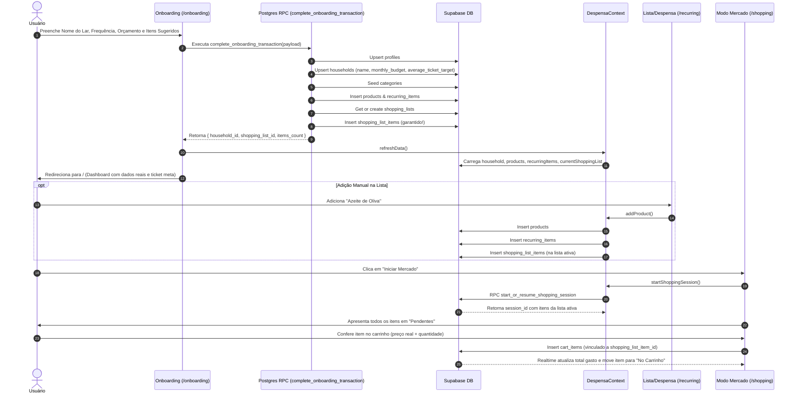

# Auditoria de Fluxo de Dados e Integridade — Despensa

## 1. Sumário Executivo

Esta auditoria forense detalha as causas raízes dos problemas críticos de persistência e integridade de dados identificados na aplicação Despensa (Next.js + Supabase), especificando o ciclo de vida completo de cada entidade, contratos de dados, e a reconciliação definitiva entre Frontend e Banco de Dados.

---

## 2. Diagnóstico da Causa Raiz

### 2.1. Causa 1: Desconexão entre Catálogo/Recorrentes e Lista de Compras Ativa
- **Ocorrência:** Itens selecionados no Onboarding ou adicionados manualmente em `/recurring` não apareciam em `/shopping` (Modo Supermercado).
- **Mecanismo da Falha:**
  1. A tela `/recurring` permitia adicionar itens, mas gravava exclusivamente nas tabelas `public.products` (catálogo) e `public.recurring_items`.
  2. O Modo Mercado (`/shopping`) consome exclusivamente a lista mensal ativa: `public.shopping_lists` e seus filhos `public.shopping_list_items`.
  3. A função `addProduct` no frontend não inseria na tabela `shopping_list_items`.
  4. Na procedure SQL `get_or_create_monthly_list`, caso a lista do mês já existisse no banco, o comando `INSERT INTO shopping_list_items` a partir de `recurring_items` era ignorado pelo `RETURN v_list_id` prematuro.
- **Resolução:** 
  - `complete_onboarding_transaction` insere os produtos selecionados diretamente em `products`, `recurring_items` e `shopping_list_items` atomicamente.
  - `get_or_create_monthly_list` sincroniza qualquer item de `recurring_items` que ainda não esteja em `shopping_list_items` usando `WHERE NOT EXISTS`.
  - `addProduct` no `despensa-context.tsx` passa a inserir simultaneamente na tabela `shopping_list_items` da lista corrente.

### 2.2. Causa 2: Assincronia e Sobrescrita de Nome do Lar e Orçamento
- **Ocorrência:** Nome do Lar e Orçamento digitados no Onboarding eram substituídos pelos valores padrão ("Nosso Lar" / R$ 0,00).
- **Mecanismo da Falha:**
  1. A migration remota falhou previamente com o erro `ERROR: 0A000: cannot alter type of a column used by a generated column (subtotal)`, impedindo a criação da RPC `complete_onboarding_transaction` e da versão de 6 parâmetros de `create_initial_household`.
  2. Ao submeter o Onboarding, as chamadas RPC falhavam com erro 404 (função não encontrada).
  3. O lar criado previamente pelo trigger de signup permanecia com o nome inicial `'Nosso Lar'` e orçamento zerado.
- **Resolução:** 
  - Migration unificada e idempotente `20241104000003_unified_data_integrity.sql` corrige a coluna gerada `subtotal`, cria a coluna `average_ticket_target` e define as RPCs transacionais atômicas.
  - Mecanismo de fallback robusto no cliente garante inserção direta via Supabase Client caso RPCs sofram instabilidade.

### 2.3. Causa 3: Divergência Semântica no "Ticket Médio"
- **Ocorrência:** Logo após o onboarding, o card de Ticket Médio exibia `R$ 0,00` em vez do valor planejado.
- **Mecanismo da Falha:**
  1. O Dashboard calculava `averageTicket = purchasesCountThisMonth > 0 ? totalSpent / purchasesCount : 0`.
  2. Para usuários recém-chegados (`purchasesCountThisMonth === 0`), o valor resultava em `0`, ignorando o teto orçamentário configurado no Onboarding.
- **Resolução:**
  - Adicionada a coluna `average_ticket_target` em `public.households`.
  - O Onboarding calcula o ticket estimado com base na frequência (`monthly_budget / tripsPerMonth`).
  - O Dashboard exibe o ticket meta planejado quando não houver compras finalizadas no mês, com rótulo descritivo "Meta estimada".

---

## 3. Matriz de Entidades e Relacionamentos

| Entidade | Papel no Sistema | Tabela Pai | Chave Estrangeira |
| :--- | :--- | :--- | :--- |
| `profiles` | Perfil do usuário (Nome, avatar do Google) | `auth.users` | `id` -> `auth.users.id` |
| `households` | Lar/despensa compartilhada (Nome, teto, ticket alvo) | - | - |
| `household_members` | Associação Usuário <-> Lar com papel (admin/member) | `households`, `profiles` | `household_id`, `user_id` |
| `categories` | Categorias do lar com ícone e cor | `households` | `household_id` |
| `products` | Catálogo de produtos cadastrados da casa | `households`, `categories` | `household_id`, `category_id` |
| `recurring_items` | Itens recorrentes da despensa com quantidade alvo | `households`, `products` | `household_id`, `product_id` |
| `shopping_lists` | Lista de compras planejada de determinado mês | `households` | `household_id` (Unique por mês/ano) |
| `shopping_list_items` | Itens planejados para a compra daquele mês | `shopping_lists`, `products` | `shopping_list_id`, `product_id` |
| `shopping_sessions` | Sessão ativa no supermercado (Modo Mercado) | `households`, `shopping_lists` | `household_id`, `shopping_list_id` |
| `cart_items` | Itens bipados/conferidos no carrinho durante a compra | `shopping_sessions`, `shopping_list_items` | `shopping_session_id`, `shopping_list_item_id` |

---

## 4. Ciclo de Vida e Fluxo de Dados Ponta a Ponta

